# Diccionario de datos

Generado automáticamente desde `backend/modelos/tablas_orm.py` con `docs/base_de_datos/generar_esquema.py`. No editar a mano.

- Motor: PostgreSQL 16. La aplicación crea las tablas sola al arrancar; el script equivalente está en [base_completa.sql](base_completa.sql); para producción en Supabase, [base_supabase_produccion.sql](base_supabase_produccion.sql).
- Tablas: 24 (22 en uso, 2 reservadas para sesiones de clase).
- Sin `DATABASE_URL` configurada, la aplicación guarda las partidas en memoria y no usa estas tablas para ellas.

## Relaciones

| Origen | Destino | Cardinalidad | Significado |
| :-- | :-- | :-: | :-- |
| `usuario` | `partida` | 1 a N | Un usuario juega muchas partidas; una partida tiene un solo dueño (opcional). |
| `partida` | `jugada` | 1 a N | Una partida tiene muchas jugadas; se borran con la partida. |
| `usuario` | `mensaje_tutor` | 1 a N | Un jugador tiene su propio historial de conversación con Turing. |
| `usuario` | `calibracion` | 1 a N | Un jugador acumula una calibración por cada partida que sirvió para medirlo. |
| `usuario` | `exportacion_dataset` | 1 a N | Un facilitador acumula una fila por cada vez que descargó el dataset de partidas. |
| `usuario` | `codigo_invitacion` | 1 a N | Un facilitador genera muchos códigos de invitación; cada uno lo usa, a lo sumo, una persona. |
| `institucion` | `usuario` | 1 a N | Una institución agrupa a sus facilitadores (docentes); cada facilitador pertenece a una sola institución. |
| `usuario` | `institucion` | 1 a 1 | Un usuario es el administrador de, a lo sumo, una institución. |
| `institucion` | `suscripcion` | 1 a 1 | Cada institución tiene una sola suscripción. |
| `usuario` | `usuario` | 1 a 1 | En el modo evaluación, un facilitador y su jugador de prueba se apuntan entre sí. |
| `institucion` | `codigo_invitacion` | 1 a N | Una institución tiene varios códigos de invitación para sus docentes. |
| `institucion` | `pago` | 1 a N | Una institución avisa muchos pagos a lo largo del tiempo. |
| `curso` | `torneo` | 1 a N | Un curso arma varios torneos relámpago. |
| `torneo` | `torneo_jugador` | 1 a N | Un torneo tiene muchos jugadores inscritos. |
| `torneo` | `torneo_partida` | 1 a N | Un torneo tiene muchas partidas, una por pareja y por ronda. |
| `curso` | `aviso_curso` | 1 a N | Un curso recibe varios avisos de su docente. |
| `curso` | `tarea_curso` | 1 a N | Un curso recibe varias tareas de su docente. |
| `usuario` | `denuncia` | 1 a N | Un jugador puede denunciar a otros o ser denunciado, varias veces. |
| `usuario` | `amistad` | 1 a N | Un jugador manda y recibe muchas solicitudes de amistad; cada amistad une a dos jugadores distintos. |
| `usuario` | `curso` | 1 a N | Un facilitador crea varios cursos; cada curso tiene un solo facilitador. |
| `curso` | `inscripcion` | 1 a N | Un curso tiene muchos jugadores inscritos. |
| `usuario` | `medalla_personalizada` | 1 a N | Un facilitador crea muchas medallas propias. |
| `usuario` | `medalla_ganada` | 1 a N | Un jugador gana muchas medallas; cada una la gana una sola vez. |
| `usuario` | `inscripcion` | 1 a 1 | Un jugador tiene, a lo sumo, una inscripción: está en un solo curso a la vez. |
| `participante` | `partida` | 1 a N | Opcional y reservada: una partida puede asignarse a un participante. |
| `sesion` | `partida` | 1 a N | Opcional y reservada: una partida puede pertenecer a una sesión de clase. |
| `usuario` | `partida` | 1 a N | Un usuario juega muchas salas como blancas; una sala tiene un blanco (opcional). |
| `usuario` | `partida` | 1 a N | Un usuario juega muchas salas como negras; una sala tiene un negro (opcional). |

## `auditoria`

Registro de lo que hacen los administradores sobre cuentas, instituciones y códigos de invitación: quién, qué y a quién. Sin datos personales; se conserva 1 año.

**Estado:** En uso

| Columna | Tipo | Nulo | Clave | Por defecto | Descripción |
| :-- | :-- | :-: | :-- | :-- | :-- |
| `id` | INTEGER | no | PK |  | Identificador del evento. |
| `creado_en` | TIMESTAMP WITHOUT TIME ZONE | no |  | now() | Fecha y hora del evento. |
| `actor_id` | INTEGER | sí |  |  | Usuario que hizo la acción. Sin clave foránea: el registro sobrevive a la baja de su cuenta. Nulo si fue el sistema. |
| `accion` | VARCHAR | no |  |  | Qué se hizo, por ejemplo `usuario.eliminar`, `usuario.baja_propia` o `institucion.crear`. |
| `objetivo_tipo` | VARCHAR | sí |  |  | Sobre qué se hizo: `usuario`, `institucion` o `codigo_invitacion`. |
| `objetivo_id` | INTEGER | sí |  |  | Identificador de lo afectado. Sin clave foránea, por la misma razón que `actor_id`. |
| `detalle` | VARCHAR | sí |  |  | Texto corto sin datos personales (por ejemplo, los campos cambiados o el rol). Opcional. |

## `institucion`

Institución cliente de la plataforma (asociación, colegio u organizador de torneos). Agrupa a sus docentes y tiene un administrador, que es quien administra su suscripción.

**Estado:** En uso

| Columna | Tipo | Nulo | Clave | Por defecto | Descripción |
| :-- | :-- | :-: | :-- | :-- | :-- |
| `id` | INTEGER | no | PK |  | Identificador de la institución. |
| `nombre` | VARCHAR | no | único |  | Nombre de la institución (por ejemplo, `Asociación Departamental de Ajedrez de Santa Cruz`). Es único. |
| `tipo` | VARCHAR | no |  | academia | `academia` (academias y clubes), `colegio` u `organizador` (de torneos y exhibiciones). |
| `administrador_id` | INTEGER | sí | FK → usuario.id |  | Usuario que administra la institución. FK → usuario.id. Nulo hasta que se designa uno. |
| `creado_en` | TIMESTAMP WITHOUT TIME ZONE | no |  | now() | Fecha y hora de creación. |
| `es_demostracion` | BOOLEAN | no |  | false | `true` en las instituciones de ejemplo que se cargan para mostrar el panel de ingresos; se quitan todas juntas. |
| `es_prueba` | BOOLEAN | no |  | false | `true` mientras es una institución de prueba, creada para que una institución evalúe el sistema antes de contratarlo. |
| `dominio_correo` | VARCHAR | sí |  |  | Dominio del correo institucional (por ejemplo `colegio.edu.bo`). Si está definido, solo entran a los cursos de sus docentes los jugadores con un correo de ese dominio. Opcional. |

## `participante`

Estudiantes de un curso, para sesiones del facilitador.

**Estado:** Reservada: el modelo existe pero ningún flujo la usa todavía

| Columna | Tipo | Nulo | Clave | Por defecto | Descripción |
| :-- | :-- | :-: | :-- | :-- | :-- |
| `id` | INTEGER | no | PK |  | Identificador del participante. |
| `nombre` | VARCHAR | no |  |  | Nombre del participante. |

## `sesion`

Sesión de clase que abre un facilitador, con su dificultad y tipo de oponente.

**Estado:** Reservada: el modelo existe pero ningún flujo la usa todavía

| Columna | Tipo | Nulo | Clave | Por defecto | Descripción |
| :-- | :-- | :-: | :-- | :-- | :-- |
| `id` | INTEGER | no | PK |  | Identificador de la sesión. |
| `facilitador` | VARCHAR | sí |  |  | Nombre del facilitador que la abrió. |
| `fecha` | TIMESTAMP WITHOUT TIME ZONE | no |  | now() | Fecha y hora de la sesión. |
| `dificultad` | INTEGER | sí |  |  | Nivel de dificultad de la sesión, de 0 a 20. |
| `tipo_oponente` | VARCHAR | sí |  |  | `motor`, `modelo` o `participante`. |

## `pago`

Pago que una institución avisa haber hecho. Queda pendiente hasta que la plataforma lo confirma; recién ahí se extiende la suscripción.

**Estado:** En uso

| Columna | Tipo | Nulo | Clave | Por defecto | Descripción |
| :-- | :-- | :-: | :-- | :-- | :-- |
| `id` | INTEGER | no | PK |  | Identificador del pago. |
| `institucion_id` | INTEGER | no | FK → institucion.id |  | Institución que pagó. FK → institucion.id. |
| `plan` | VARCHAR | no |  |  | Plan que se pagó (`plan_60` o `plan_120`). |
| `ciclo` | VARCHAR | no |  |  | Ciclo que se pagó: `mensual`, `trimestral` o `anual`. |
| `monto_bs` | INTEGER | no |  |  | Monto en bolivianos, ya con el descuento del ciclo. |
| `estado` | VARCHAR | no |  | pendiente | `pendiente` (avisado, sin confirmar), `confirmado` (la plataforma lo confirmó) o `rechazado`. |
| `referencia` | VARCHAR | sí |  |  | Lo que escribió la institución para que la plataforma lo encuentre (número de transferencia, nombre del titular…). Opcional. |
| `creado_en` | TIMESTAMP WITHOUT TIME ZONE | no |  | now() | Fecha y hora en que la institución avisó el pago. |
| `resuelto_en` | TIMESTAMP WITHOUT TIME ZONE | sí |  |  | Fecha y hora en que la plataforma lo confirmó o rechazó. |
| `resuelto_por` | INTEGER | sí |  |  | Usuario de la plataforma que lo resolvió. Sin clave foránea: el registro sobrevive a su cuenta. |
| `periodo_hasta` | TIMESTAMP WITHOUT TIME ZONE | sí |  |  | Hasta cuándo quedó pagada la suscripción con este pago (solo si se confirmó). |
| `nota` | VARCHAR | sí |  |  | Comentario de la plataforma al resolver (por ejemplo, el motivo de un rechazo). Opcional. |

## `suscripcion`

Suscripción de una institución: su plan (hasta 60 o hasta 120 alumnos), cuándo termina la prueba gratis (30 días por defecto) y hasta cuándo está pagada. El estado (prueba, activa o vencida) se calcula con las fechas.

**Estado:** En uso

| Columna | Tipo | Nulo | Clave | Por defecto | Descripción |
| :-- | :-- | :-: | :-- | :-- | :-- |
| `id` | INTEGER | no | PK |  | Identificador de la suscripción. |
| `institucion_id` | INTEGER | no | FK → institucion.id, único |  | Institución a la que pertenece. FK → institucion.id. Única: cada institución tiene una sola suscripción. |
| `plan` | VARCHAR | no |  | plan_60 | `plan_60` (hasta 60 alumnos, Bs 350 al mes) o `plan_120` (hasta 120 alumnos, Bs 500 al mes). |
| `ciclo` | VARCHAR | no |  | mensual | Ciclo del último pago: `mensual`, `trimestral` (10 % de descuento) o `anual` (paga 10 meses de 12). |
| `prueba_hasta` | TIMESTAMP WITHOUT TIME ZONE | no |  |  | Fecha y hora en que termina la prueba gratis (30 días desde que se creó, o el plazo que se haya elegido al dar de alta). |
| `vigente_hasta` | TIMESTAMP WITHOUT TIME ZONE | sí |  |  | Fecha y hora hasta la que está pagada. Nulo si nunca pagó. |
| `creado_en` | TIMESTAMP WITHOUT TIME ZONE | no |  | now() | Fecha y hora de creación. |

## `usuario`

Personas que usan el sistema, con su rol, su nivel de juego y su perfil.

**Estado:** En uso

| Columna | Tipo | Nulo | Clave | Por defecto | Descripción |
| :-- | :-- | :-: | :-- | :-- | :-- |
| `id` | INTEGER | no | PK |  | Identificador del usuario. |
| `email` | VARCHAR | no | único |  | Correo del usuario; es único y se usa para iniciar sesión. |
| `nombre` | VARCHAR | no |  |  | Nombre visible. |
| `password_hash` | VARCHAR | sí |  |  | Hash de la contraseña (nunca se guarda en claro). Nulo si entra solo con Google. |
| `rol` | VARCHAR | no |  | jugador | `jugador` o `facilitador`. |
| `creado_en` | TIMESTAMP WITHOUT TIME ZONE | no |  | now() | Fecha y hora de registro. |
| `activo` | BOOLEAN | no |  | True | Indica si la cuenta está habilitada. |
| `google_id` | VARCHAR | sí |  |  | Identificador de Google cuando entra con su cuenta de Google. |
| `avatar_url` | VARCHAR | sí |  |  | Ruta o URL de la foto de perfil. |
| `nivel_estimado` | INTEGER | sí |  |  | Nivel de juego vigente, de 0 a 20 (la escala del Skill Level de Stockfish). Lo recalcula el sistema al terminar cada partida, o lo fija el jugador como punto de partida desde su perfil. |
| `rango_estimado` | VARCHAR | sí |  |  | `Principiante` (niveles 0-6), `Intermedio` (7-13) o `Avanzado` (14-20). |
| `edad` | INTEGER | sí |  |  | Edad, de uso libre en el perfil. |
| `descripcion` | VARCHAR | sí |  |  | Biografía o trayectoria breve, de uso libre en el perfil. |
| `preset_ensenanza` | VARCHAR | sí |  |  | Tono con el que Turing habla: `infantil`, `estandar` o `adultos`. Lo elige el facilitador. |
| `institucion_id` | INTEGER | sí | FK → institucion.id |  | Institución a la que pertenece un facilitador (docente o administrador). FK → institucion.id. Nulo en los jugadores, cuya institución se deduce de su curso, y en los facilitadores de la plataforma. |
| `correo_verificado` | BOOLEAN | no |  | true | `true` si el correo está verificado. Las cuentas anteriores y las de Google lo están; una cuenta nueva con contraseña queda en `false` solo si el servidor tiene configurado el envío de correo. |
| `correo_verificado_en` | TIMESTAMP WITHOUT TIME ZONE | sí |  |  | Fecha de comprobación de la propiedad del correo por código o Google. Nulo para cuentas antiguas o creadas sin envío de correo. Exigido al ingresar por dominio institucional. |
| `codigo_verificacion_hash` | VARCHAR | sí |  |  | Huella SHA-256 del código de 6 dígitos enviado al correo. El código en claro no se guarda. |
| `codigo_verificacion_expira` | TIMESTAMP WITHOUT TIME ZONE | sí |  |  | Fecha y hora a partir de la cual el código de verificación ya no sirve (15 minutos). |
| `recuperacion_password_hash` | VARCHAR | sí |  |  | Huella del código de recuperación de contraseña, ligada a la contraseña vigente. Nunca se guarda el código en claro. |
| `recuperacion_password_expira` | TIMESTAMP WITHOUT TIME ZONE | sí |  |  | Vencimiento UTC del código de recuperación de contraseña (15 minutos). |
| `version_credenciales` | INTEGER | no |  | 0 | Versión incluida en los tokens. Aumenta al cambiar o restablecer la contraseña para invalidar sesiones anteriores. |
| `totp_activo` | BOOLEAN | no |  | false | `true` si el facilitador activó la verificación en dos pasos (app de códigos como Google Authenticator). |
| `totp_secreto` | VARCHAR | sí |  |  | Secreto de la app de códigos, CIFRADO con una clave derivada de `JWT_SECRET_KEY`. Nulo si nunca lo preparó. |
| `totp_ultimo_paso` | INTEGER | sí |  |  | Último paso de 30 segundos cuyo código se aceptó: impide usar el mismo código dos veces. |
| `totp_codigos_respaldo` | VARCHAR | sí |  |  | Lista (JSON) de huellas SHA-256 de los códigos de respaldo que le quedan. Los códigos en claro no se guardan. |
| `cuenta_vinculada_id` | INTEGER | sí | FK → usuario.id |  | Cuenta con la que se alterna en el modo evaluación: un facilitador que prueba el sistema como director apunta a su jugador de prueba, y viceversa. FK → usuario.id. Nulo en el resto de las cuentas. |
| `codigo_amigo` | VARCHAR | sí |  |  | Código corto para que otro jugador le mande una solicitud de amistad sin saber su correo (se comparte por WhatsApp). Se genera la primera vez que se pide. Nulo hasta entonces. |
| `tutor_nombre` | VARCHAR | sí |  |  | Nombre de la madre, el padre o el tutor de un jugador menor de edad. Lo ven solo el propio jugador, su docente, el administrador de su institución y la plataforma. |
| `tutor_telefono` | VARCHAR | sí |  |  | Teléfono (WhatsApp) del tutor, para que el docente pueda avisarle si pasa algo. |
| `tutor_email` | VARCHAR | sí |  |  | Correo opcional de la madre, el padre o el tutor para compartir el progreso o contactarse. Privado, con el mismo alcance que el teléfono. |
| `autorizacion_tutor_en` | TIMESTAMP WITHOUT TIME ZONE | sí |  |  | Fecha y hora en que se declaró que el tutor autoriza el uso de ChessIA. Nulo si no se declaró. |
| `cuenta_gestionada` | BOOLEAN | no |  | false | `true` si la cuenta la creó un docente para un alumno sin correo: el alumno entra con un usuario y una clave que el docente le entrega. |

## `amistad`

Amistad entre dos jugadores que no comparten curso (los compañeros de curso no la necesitan para jugar entre sí). Una solicitud queda pendiente hasta que el destinatario la acepta; si la rechaza, la fila se borra.

**Estado:** En uso

| Columna | Tipo | Nulo | Clave | Por defecto | Descripción |
| :-- | :-- | :-: | :-- | :-- | :-- |
| `id` | INTEGER | no | PK |  | Identificador de la amistad. |
| `solicitante_id` | INTEGER | no | FK → usuario.id |  | Jugador que mandó la solicitud. FK → usuario.id. |
| `destinatario_id` | INTEGER | no | FK → usuario.id |  | Jugador que la recibe y la acepta o la rechaza. FK → usuario.id. |
| `estado` | VARCHAR | no |  | pendiente | `pendiente` (esperando respuesta) o `aceptada`. Una solicitud rechazada se borra. |
| `creada_en` | TIMESTAMP WITHOUT TIME ZONE | no |  | now() | Fecha y hora en que se mandó la solicitud. |
| `respondida_en` | TIMESTAMP WITHOUT TIME ZONE | sí |  |  | Fecha y hora en que el destinatario la aceptó. Nulo mientras está pendiente. |

**Restricciones:** `uq_amistad_par` único (solicitante_id, destinatario_id).

## `calibracion`

Una fila por partida terminada que sirvió para medir el nivel del jugador. Con las últimas tres se calcula su nivel vigente.

**Estado:** En uso

| Columna | Tipo | Nulo | Clave | Por defecto | Descripción |
| :-- | :-- | :-: | :-- | :-- | :-- |
| `id` | INTEGER | no | PK |  | Identificador de la calibración. |
| `usuario_id` | INTEGER | no | FK → usuario.id |  | Jugador medido. |
| `partida_id` | VARCHAR | no |  |  | Partida que se usó para medir. No es clave foránea a propósito: una partida puede vivir solo en memoria y no tener fila en `partida`. |
| `precision_global` | FLOAT | no |  |  | Precisión del jugador en esa partida, de 0 a 100: compara solo sus jugadas con las de Stockfish. |
| `nivel_partida` | INTEGER | no |  |  | Nivel (0-20) que saldría mirando solamente esa partida. |
| `rango_partida` | VARCHAR | no |  |  | Rango que saldría mirando solamente esa partida. |
| `total_jugadas` | INTEGER | no |  |  | Cantidad de jugadas del jugador que se evaluaron (mínimo 5 para registrarla). |
| `creado_en` | TIMESTAMP WITHOUT TIME ZONE | no |  | now() | Fecha y hora en que se registró. |

**Restricciones:** `uq_calibracion_usuario_partida` único (usuario_id, partida_id).

## `codigo_invitacion`

Códigos de un solo uso, con vencimiento, que un facilitador genera para que otra persona pueda registrarse como facilitador. Solo se guarda su hash.

**Estado:** En uso

| Columna | Tipo | Nulo | Clave | Por defecto | Descripción |
| :-- | :-- | :-: | :-- | :-- | :-- |
| `id` | INTEGER | no | PK |  | Identificador del código. |
| `codigo_hash` | VARCHAR | no | único |  | Huella SHA-256 del código. El código en claro no se guarda: solo se ve al generarlo. |
| `creado_por` | INTEGER | sí | FK → usuario.id |  | Facilitador que lo generó. |
| `para` | VARCHAR | sí |  |  | A quién se lo dio (texto libre, opcional), solo para acordarse. |
| `creado_en` | TIMESTAMP WITHOUT TIME ZONE | no |  | now() | Fecha y hora en que se generó. |
| `expira_en` | TIMESTAMP WITHOUT TIME ZONE | no |  |  | Fecha y hora a partir de la cual el código ya no sirve. |
| `usado_en` | TIMESTAMP WITHOUT TIME ZONE | sí |  |  | Fecha y hora en que se usó. Nulo mientras no se haya usado: sirve una sola vez. |
| `usado_por` | INTEGER | sí | FK → usuario.id |  | Usuario que se registró con este código. |
| `institucion_id` | INTEGER | sí | FK → institucion.id |  | Institución para la que se generó. FK → institucion.id. Quien se registra con el código queda dentro de ella. Nulo si solo da permiso para registrarse como facilitador. |
| `como_administrador` | BOOLEAN | no |  | false | `true` si quien se registra con el código queda como administrador de la institución (solo lo genera la plataforma). |
| `es_evaluacion` | BOOLEAN | no |  | false | `true` si es una invitación para evaluar el sistema: a quien se registre se le crea además un jugador de prueba. |

## `curso`

Grupo de estudiantes de un facilitador. Los jugadores entran con un código del curso, que sirve para muchos y el facilitador puede volver a ver y regenerar.

**Estado:** En uso

| Columna | Tipo | Nulo | Clave | Por defecto | Descripción |
| :-- | :-- | :-: | :-- | :-- | :-- |
| `id` | INTEGER | no | PK |  | Identificador del curso. |
| `nombre` | VARCHAR | no |  |  | Nombre del curso, que elige el facilitador (por ejemplo, `Ajedrez 1ro A`). |
| `facilitador_id` | INTEGER | no | FK → usuario.id |  | Facilitador dueño del curso. FK → usuario.id. |
| `codigo` | VARCHAR | no | único |  | Código de 6 caracteres (alfabeto sin ambiguos) que el facilitador le da a la clase. Es único, sirve para muchos jugadores y se guarda en claro porque solo permite entrar al curso como jugador. |
| `acepta_ingresos` | BOOLEAN | no |  | true | Si es falso, el código no deja entrar a nadie más; los ya inscritos siguen. |
| `cupo` | INTEGER | no |  | 60 | Cantidad máxima de jugadores que pueden inscribirse, de 1 a 120 (60 por defecto). Lo define quien crea el curso. |
| `preset_ensenanza` | VARCHAR | sí |  |  | Tono con el que Turing les habla a los jugadores de este curso: `infantil`, `estandar` o `adultos`. Nulo = se usa el tono que eligió el facilitador en su perfil. |
| `permite_retos` | BOOLEAN | no |  | true | «Modo clase»: si es falso, los alumnos del curso no pueden retarse, buscar rival ni jugar salas entre ellos (el docente lo pausa mientras explica). |
| `autorizacion_familias` | BOOLEAN | no |  | false | El docente (o la institución) declara que tiene la autorización de las familias de los alumnos de este curso. Con eso los alumnos menores no cargan los datos de un tutor uno por uno para jugar con sus compañeros. |
| `autorizacion_familias_en` | TIMESTAMP WITHOUT TIME ZONE | sí |  |  | Fecha y hora en que se hizo esa declaración. Nulo si no se hizo. |
| `creado_en` | TIMESTAMP WITHOUT TIME ZONE | no |  | now() | Fecha y hora de creación. |

## `denuncia`

Denuncia de un jugador contra otro (conducta, trampa o abandonos). La revisa el docente del denunciado, el administrador de su institución o la plataforma.

**Estado:** En uso

| Columna | Tipo | Nulo | Clave | Por defecto | Descripción |
| :-- | :-- | :-: | :-- | :-- | :-- |
| `id` | INTEGER | no | PK |  | Identificador de la denuncia. |
| `denunciante_id` | INTEGER | no | FK → usuario.id |  | Jugador que denuncia. FK → usuario.id. |
| `denunciado_id` | INTEGER | no | FK → usuario.id |  | Jugador denunciado. FK → usuario.id. |
| `motivo` | VARCHAR | no |  |  | `conducta`, `trampa`, `abandono` u `otro`. |
| `detalle` | VARCHAR | sí |  |  | Lo que escribió quien denuncia (hasta 300 caracteres). Opcional. |
| `codigo_sala` | VARCHAR | sí |  |  | Código de la sala donde pasó, si fue en una partida. Opcional. |
| `estado` | VARCHAR | no |  | nueva | `nueva` o `revisada`. |
| `creada_en` | TIMESTAMP WITHOUT TIME ZONE | no |  | now() | Fecha y hora en que se hizo. |
| `resuelta_en` | TIMESTAMP WITHOUT TIME ZONE | sí |  |  | Fecha y hora en que un docente o la plataforma la marcó como revisada. |
| `resuelta_por` | INTEGER | sí |  |  | Usuario que la revisó. Sin clave foránea: el registro sobrevive a su cuenta. |

## `exportacion_dataset`

Una fila por cada vez que un facilitador descargó el dataset de partidas para reentrenar el modelo propio (HU4, todavía pendiente de construir).

**Estado:** En uso

| Columna | Tipo | Nulo | Clave | Por defecto | Descripción |
| :-- | :-- | :-: | :-- | :-- | :-- |
| `id` | INTEGER | no | PK |  | Identificador de la descarga. |
| `usuario_id` | INTEGER | no | FK → usuario.id |  | Facilitador que descargó el dataset. |
| `creado_en` | TIMESTAMP WITHOUT TIME ZONE | no |  | now() | Fecha y hora en que se generó la descarga. |
| `corte_en` | TIMESTAMP WITHOUT TIME ZONE | no |  |  | Instante de corte de esta descarga: la fecha más reciente entre las partidas incluidas. Sirve para saber qué partidas son "nuevas" en la próxima descarga. |
| `cantidad_partidas` | INTEGER | no |  |  | Cuántas partidas incluyó esta descarga. |
| `cantidad_jugadas` | INTEGER | no |  |  | Cuántas jugadas del jugador incluyó esta descarga. |
| `formato` | VARCHAR | no |  |  | Formato del archivo entregado, por ejemplo `pgn+csv`. |

## `medalla_ganada`

Medallas (figuritas) que cada jugador ya ganó, con la fecha. Son permanentes. El catálogo de medallas vive en el código (`backend/servicios/medallas/catalogo.py`).

**Estado:** En uso

| Columna | Tipo | Nulo | Clave | Por defecto | Descripción |
| :-- | :-- | :-: | :-- | :-- | :-- |
| `id` | INTEGER | no | PK |  | Identificador de la medalla ganada. |
| `usuario_id` | INTEGER | no | FK → usuario.id |  | Jugador que la ganó. FK → usuario.id. |
| `codigo` | VARCHAR | no |  |  | Código de la medalla en el catálogo (por ejemplo `primer_peon`). Único por jugador. |
| `ganada_en` | TIMESTAMP WITHOUT TIME ZONE | no |  | now() | Fecha y hora en que la ganó. |
| `vista_en` | TIMESTAMP WITHOUT TIME ZONE | sí |  |  | Cuándo se le mostró el aviso de nueva medalla. Nulo = todavía no se le avisó. |

**Restricciones:** `uq_medalla_ganada_usuario_codigo` único (usuario_id, codigo).

## `medalla_personalizada`

Medallas que crean los facilitadores (nombre, descripción, nivel, pieza, regla para ganarla y alcance). Las 13 medallas de fábrica no están acá: viven en el código.

**Estado:** En uso

| Columna | Tipo | Nulo | Clave | Por defecto | Descripción |
| :-- | :-- | :-: | :-- | :-- | :-- |
| `id` | INTEGER | no | PK |  | Identificador de la medalla. |
| `codigo` | VARCHAR | no | único |  | Código único y estable (`propia_` y 8 caracteres): es la clave de las medallas ganadas y de su imagen. |
| `nombre` | VARCHAR | no |  |  | Nombre corto de la medalla. |
| `descripcion` | VARCHAR | no |  |  | Frase que dice cómo se gana. |
| `nivel` | VARCHAR | no |  |  | `bronce`, `plata`, `oro` o `legendaria`: define el color y el brillo del escudo. |
| `pieza` | VARCHAR | no |  | peon | Silueta de pieza que se muestra mientras no tenga imagen propia. |
| `regla` | VARCHAR | no |  |  | Cómo se gana: una regla automática (por ejemplo `victorias`) o `manual`. |
| `meta` | INTEGER | no |  | 1 | Cantidad que hay que alcanzar con la regla (1 en las manuales y en las de sí o no). |
| `general` | BOOLEAN | no |  | false | Verdadero: la ven todos los jugadores (solo el facilitador principal puede crearlas así). Falso: solo los de los cursos de su creador. |
| `creada_por` | INTEGER | no | FK → usuario.id |  | Facilitador que la creó. FK → usuario.id. |
| `creada_en` | TIMESTAMP WITHOUT TIME ZONE | no |  | now() | Fecha y hora de creación. |

## `mensaje_tutor`

Historial de la conversación de cada jugador con el tutor Turing (memoria multi-turno).

**Estado:** En uso

| Columna | Tipo | Nulo | Clave | Por defecto | Descripción |
| :-- | :-- | :-: | :-- | :-- | :-- |
| `id` | INTEGER | no | PK |  | Identificador del mensaje. |
| `usuario_id` | INTEGER | no | FK → usuario.id |  | Jugador que conversa con el tutor. |
| `rol` | VARCHAR | no |  |  | `user` (lo escribió el jugador) o `assistant` (respondió Turing). |
| `contenido` | VARCHAR | no |  |  | Texto del mensaje. |
| `creado_en` | TIMESTAMP WITHOUT TIME ZONE | no |  | now() | Fecha y hora del mensaje. |

## `partida`

Cada partida jugada: quién la jugó, contra qué oponente, a qué nivel, la posición actual y las funciones opcionales que el facilitador habilitó.

**Estado:** En uso

| Columna | Tipo | Nulo | Clave | Por defecto | Descripción |
| :-- | :-- | :-: | :-- | :-- | :-- |
| `id` | VARCHAR | no | PK |  | Identificador de la partida: un UUID en hexadecimal (texto), no un número. |
| `usuario_id` | INTEGER | sí | FK → usuario.id |  | Dueño de la partida. Nulo en partidas antiguas o de prueba sin dueño. |
| `participante_id` | INTEGER | sí | FK → participante.id |  | Reservado para sesiones de clase. Hoy siempre nulo. |
| `sesion_id` | INTEGER | sí | FK → sesion.id |  | Reservado para sesiones de clase. Hoy siempre nulo. |
| `fecha` | TIMESTAMP WITHOUT TIME ZONE | no |  | now() | Fecha y hora de creación. |
| `resultado` | VARCHAR | sí |  |  | `1-0`, `0-1` o `1/2-1/2`. Nulo mientras la partida sigue en curso o no se terminó. |
| `tipo` | VARCHAR | no |  |  | `digital` (se juega en pantalla) o `fisica` (con el tablero real detectado por visión). |
| `fen` | VARCHAR | no |  |  | Posición actual del tablero en notación FEN. |
| `fen_inicial` | VARCHAR | sí |  |  | Posición desde la que arrancó la partida (FEN). Nulo en partidas antiguas. |
| `nivel` | INTEGER | no |  |  | Nivel del oponente elegido al crear la partida, de 0 a 20. No cambia durante la partida. |
| `tipo_oponente` | VARCHAR | no |  | motor | `motor` (Stockfish) o `modelo` (Turing, el modelo propio). |
| `jugadas_uci` | VARCHAR | no |  |  | Todas las jugadas en notación UCI separadas por espacio; permite reconstruir el tablero. |
| `permite_simulacion_3d` | BOOLEAN | no |  | false | El facilitador habilitó la simulación 3D para esta partida. |
| `permite_camara` | BOOLEAN | no |  | false | El facilitador habilitó la cámara del tablero físico para esta partida. |
| `es_demostracion` | BOOLEAN | no |  | false | Partida que el facilitador transmite en vivo a la clase. Solo una a la vez en todo el sistema. |
| `usa_brazo` | BOOLEAN | no |  | false | La respuesta del oponente también se ejecuta en el brazo robótico (o su simulador). |
| `estado` | VARCHAR | no |  | en_curso | `esperando`, `en_curso`, `terminada` o `abandonada`. Lo administra el ciclo de vida de la partida. `esperando` = sala creada, falta segundo jugador (solo `humano`). |
| `iniciada_en` | TIMESTAMP WITHOUT TIME ZONE | sí |  |  | Momento de la primera jugada del jugador humano. Nulo si todavía no jugó ninguna. |
| `actualizada_en` | TIMESTAMP WITHOUT TIME ZONE | sí |  |  | Momento de la última jugada aplicada (humano o estrategia). Nulo hasta la primera jugada. |
| `control_tiempo_ms` | INTEGER | no |  | 0 | Control de tiempo: milisegundos que tiene cada lado para toda la partida. 0 = sin reloj. Se elige al crear la partida. |
| `tiempo_blancas_ms` | INTEGER | sí |  |  | Tiempo que le queda al jugador humano (blancas), en milisegundos. Nulo = todavía tiene el control completo. Permite reanudar la partida con el reloj donde se quedó. |
| `tiempo_negras_ms` | INTEGER | sí |  |  | Tiempo que le queda al rival (negras), en milisegundos. Nulo = todavía tiene el control completo. |
| `tiempos_jugadas_ms` | VARCHAR | no |  |  | Milisegundos que tardó cada jugada, separados por espacio y en el mismo orden que las jugadas; `-` si no se midió. Alimenta el tiempo por jugada del análisis y la retroalimentación. |
| `codigo_sala` | VARCHAR | sí |  |  | Código corto de 6 caracteres para compartir la sala (alfabeto sin ambiguos). Único donde no es nulo (índice único parcial). Solo partidas `tipo_oponente = 'humano'`. |
| `usuario_blancas_id` | INTEGER | sí | FK → usuario.id |  | Usuario que juega con blancas en la sala. Nulo si el asiento está libre. FK → usuario.id. |
| `usuario_negras_id` | INTEGER | sí | FK → usuario.id |  | Usuario que juega con negras en la sala. Nulo si el asiento está libre. FK → usuario.id. |

## `aviso_curso`

Aviso de un docente a su curso (una consigna, el enlace de una clase en vivo). Es en un solo sentido: los alumnos lo leen, no responden.

**Estado:** En uso

| Columna | Tipo | Nulo | Clave | Por defecto | Descripción |
| :-- | :-- | :-: | :-- | :-- | :-- |
| `id` | INTEGER | no | PK |  | Identificador del aviso. |
| `curso_id` | INTEGER | no | FK → curso.id |  | Curso al que va dirigido. FK → curso.id. |
| `autor_id` | INTEGER | no |  |  | Docente que lo escribió. Sin clave foránea: el aviso sobrevive a su cuenta. |
| `texto` | VARCHAR | no |  |  | El mensaje (hasta 500 caracteres). |
| `enlace` | VARCHAR | sí |  |  | Un enlace opcional, por ejemplo el de una clase en vivo. |
| `creado_en` | TIMESTAMP WITHOUT TIME ZONE | no |  | now() | Fecha y hora en que se publicó. |

## `inscripcion`

Un jugador dentro de un curso. Un jugador está en un solo curso a la vez.

**Estado:** En uso

| Columna | Tipo | Nulo | Clave | Por defecto | Descripción |
| :-- | :-- | :-: | :-- | :-- | :-- |
| `id` | INTEGER | no | PK |  | Identificador de la inscripción. |
| `curso_id` | INTEGER | no | FK → curso.id |  | Curso en el que está el jugador. FK → curso.id. |
| `usuario_id` | INTEGER | no | FK → usuario.id, único |  | Jugador inscrito. Único: está en un solo curso a la vez. FK → usuario.id. |
| `unido_en` | TIMESTAMP WITHOUT TIME ZONE | no |  | now() | Fecha y hora en que entró al curso. |

## `jugada`

Detalle de cada jugada de una partida: quién la decidió y cómo la evaluó Stockfish.

**Estado:** En uso

| Columna | Tipo | Nulo | Clave | Por defecto | Descripción |
| :-- | :-- | :-: | :-- | :-- | :-- |
| `id` | INTEGER | no | PK |  | Identificador de la jugada. |
| `partida_id` | VARCHAR | no | FK → partida.id |  | Partida a la que pertenece. |
| `numero` | INTEGER | no |  |  | Número de la jugada dentro de la partida (1, 2, 3...). Las impares son del jugador humano. |
| `fen_antes` | VARCHAR | no |  |  | Posición (FEN) justo antes de jugarla. |
| `movimiento` | VARCHAR | no |  |  | Jugada en notación UCI, por ejemplo `e2e4`. |
| `decidido_por` | VARCHAR | sí |  |  | Quién la jugó: `jugador`, `motor` o `modelo`. |
| `tiempo_calculo_ms` | INTEGER | sí |  |  | Milisegundos que tardó en calcularse. Nulo si no se midió. |
| `explicacion` | VARCHAR | sí |  |  | Explicación en lenguaje natural de la jugada. Nulo si no se generó. |
| `evaluacion_cp` | INTEGER | sí |  |  | Evaluación de Stockfish, en centipeones, del resultado de la jugada realmente jugada. |
| `mate_en` | INTEGER | sí |  |  | Si tras la jugada hay mate forzado, en cuántas jugadas. Nulo si no lo hay. |
| `evaluacion_mejor_cp` | INTEGER | sí |  |  | Evaluación, en centipeones, de la mejor jugada posible en esa posición. |
| `mate_en_mejor` | INTEGER | sí |  |  | Mate forzado disponible con la mejor jugada. Nulo si no lo había. |

## `tarea_curso`

Tarea de un docente para su curso, con una meta que el sistema mide solo con lo que los alumnos juegan (partidas contra la IA, partidas entre compañeros o precisión).

**Estado:** En uso

| Columna | Tipo | Nulo | Clave | Por defecto | Descripción |
| :-- | :-- | :-: | :-- | :-- | :-- |
| `id` | INTEGER | no | PK |  | Identificador de la tarea. |
| `curso_id` | INTEGER | no | FK → curso.id |  | Curso al que se le pone. FK → curso.id. |
| `autor_id` | INTEGER | no |  |  | Docente que la puso. Sin clave foránea: la tarea sobrevive a su cuenta. |
| `titulo` | VARCHAR | no |  |  | Cómo se la presenta a los alumnos. |
| `tipo` | VARCHAR | no |  |  | Qué se mide: `partidas_ia` (partidas terminadas contra Turing o Stockfish), `partidas_amigos` (partidas terminadas contra compañeros o amigos) o `precision` (una partida con esa precisión o más). |
| `meta` | INTEGER | no |  |  | La cantidad de partidas, o el porcentaje de precisión, que hay que alcanzar. |
| `desde` | TIMESTAMP WITHOUT TIME ZONE | no |  |  | Desde cuándo cuenta lo que juegan. |
| `hasta` | TIMESTAMP WITHOUT TIME ZONE | no |  |  | Hasta cuándo cuenta (fecha límite). |
| `creada_en` | TIMESTAMP WITHOUT TIME ZONE | no |  | now() | Fecha y hora en que se puso. |

## `torneo`

Torneo relámpago de un curso (sistema suizo): nombre, reloj, cantidad de rondas y en qué ronda va. El docente lo arma y empareja cada ronda.

**Estado:** En uso

| Columna | Tipo | Nulo | Clave | Por defecto | Descripción |
| :-- | :-- | :-: | :-- | :-- | :-- |
| `id` | INTEGER | no | PK |  | Identificador del torneo. |
| `curso_id` | INTEGER | no | FK → curso.id |  | Curso al que pertenece. FK → curso.id. |
| `nombre` | VARCHAR | no |  |  | Nombre del torneo, que elige el docente. |
| `control_tiempo_ms` | INTEGER | no |  | 0 | Milisegundos por lado de cada partida (`0` = sin reloj). |
| `rondas` | INTEGER | no |  | 3 | Cuántas rondas tiene (de 1 a 9). |
| `ronda_actual` | INTEGER | no |  | 0 | La ronda que se está jugando (0 mientras se inscriben). |
| `estado` | VARCHAR | no |  | inscripcion | `inscripcion`, `en_juego` o `terminado`. |
| `creado_por` | INTEGER | no |  |  | Docente que lo armó. Sin clave foránea: el torneo sobrevive a su cuenta. |
| `creado_en` | TIMESTAMP WITHOUT TIME ZONE | no |  | now() | Fecha y hora de creación. |

## `torneo_jugador`

Jugador inscrito en un torneo, con sus puntos (1 por victoria, 0,5 por tablas, 1 por descanso).

**Estado:** En uso

| Columna | Tipo | Nulo | Clave | Por defecto | Descripción |
| :-- | :-- | :-: | :-- | :-- | :-- |
| `id` | INTEGER | no | PK |  | Identificador de la inscripción. |
| `torneo_id` | INTEGER | no | FK → torneo.id |  | Torneo en el que juega. FK → torneo.id. |
| `usuario_id` | INTEGER | no | FK → usuario.id |  | Jugador inscrito. FK → usuario.id. |
| `puntos` | FLOAT | no |  | 0 | Puntos acumulados: 1 por victoria, 0,5 por tablas, 1 por descanso. |
| `descansos` | INTEGER | no |  | 0 | Rondas en que le tocó descansar (cuando los jugadores son impares). |
| `inscrito_en` | TIMESTAMP WITHOUT TIME ZONE | no |  | now() | Fecha y hora en que se inscribió. |

**Restricciones:** `uq_torneo_jugador` único (torneo_id, usuario_id).

## `torneo_partida`

Una partida de una ronda de un torneo: quién juega con blancas y con negras, su sala y cómo terminó.

**Estado:** En uso

| Columna | Tipo | Nulo | Clave | Por defecto | Descripción |
| :-- | :-- | :-: | :-- | :-- | :-- |
| `id` | INTEGER | no | PK |  | Identificador de la partida del torneo. |
| `torneo_id` | INTEGER | no | FK → torneo.id |  | Torneo al que pertenece. FK → torneo.id. |
| `ronda` | INTEGER | no |  |  | Ronda en que se juega. |
| `blancas_id` | INTEGER | no | FK → usuario.id |  | Jugador de blancas. FK → usuario.id. |
| `negras_id` | INTEGER | sí | FK → usuario.id |  | Jugador de negras. FK → usuario.id. Nulo si el de blancas descansa esa ronda. |
| `codigo_sala` | VARCHAR | sí |  |  | Código de la sala donde se juega. |
| `resultado` | VARCHAR | sí |  |  | `1-0`, `0-1`, `1/2-1/2` o `0-0` (nadie jugó). Nulo mientras se juega. |

## Diagrama entidad-relación (Mermaid)

```mermaid
erDiagram
    usuario |o--o{ partida : tiene
    partida ||--o{ jugada : tiene
    usuario ||--o{ mensaje_tutor : tiene
    usuario ||--o{ calibracion : tiene
    usuario ||--o{ exportacion_dataset : tiene
    usuario ||--o{ codigo_invitacion : tiene
    institucion ||--o{ usuario : tiene
    usuario ||--o{ institucion : tiene
    institucion ||--o{ suscripcion : tiene
    usuario ||--o{ usuario : tiene
    institucion ||--o{ codigo_invitacion : tiene
    institucion ||--o{ pago : tiene
    curso ||--o{ torneo : tiene
    torneo ||--o{ torneo_jugador : tiene
    torneo ||--o{ torneo_partida : tiene
    curso ||--o{ aviso_curso : tiene
    curso ||--o{ tarea_curso : tiene
    usuario ||--o{ denuncia : tiene
    usuario ||--o{ amistad : tiene
    usuario ||--o{ curso : tiene
    curso ||--o{ inscripcion : tiene
    usuario ||--o{ medalla_personalizada : tiene
    usuario ||--o{ medalla_ganada : tiene
    usuario ||--o{ inscripcion : tiene
    participante |o--o{ partida : tiene
    sesion |o--o{ partida : tiene
    usuario |o--o{ partida : tiene
    usuario |o--o{ partida : tiene
    auditoria {
        INTEGER id PK
        TIMESTAMP creado_en
        INTEGER actor_id
        VARCHAR accion
        VARCHAR objetivo_tipo
        INTEGER objetivo_id
        VARCHAR detalle
    }
    institucion {
        INTEGER id PK
        VARCHAR nombre
        VARCHAR tipo
        INTEGER administrador_id FK
        TIMESTAMP creado_en
        BOOLEAN es_demostracion
        BOOLEAN es_prueba
        VARCHAR dominio_correo
    }
    participante {
        INTEGER id PK
        VARCHAR nombre
    }
    sesion {
        INTEGER id PK
        VARCHAR facilitador
        TIMESTAMP fecha
        INTEGER dificultad
        VARCHAR tipo_oponente
    }
    pago {
        INTEGER id PK
        INTEGER institucion_id FK
        VARCHAR plan
        VARCHAR ciclo
        INTEGER monto_bs
        VARCHAR estado
        VARCHAR referencia
        TIMESTAMP creado_en
        TIMESTAMP resuelto_en
        INTEGER resuelto_por
        TIMESTAMP periodo_hasta
        VARCHAR nota
    }
    suscripcion {
        INTEGER id PK
        INTEGER institucion_id FK
        VARCHAR plan
        VARCHAR ciclo
        TIMESTAMP prueba_hasta
        TIMESTAMP vigente_hasta
        TIMESTAMP creado_en
    }
    usuario {
        INTEGER id PK
        VARCHAR email
        VARCHAR nombre
        VARCHAR password_hash
        VARCHAR rol
        TIMESTAMP creado_en
        BOOLEAN activo
        VARCHAR google_id
        VARCHAR avatar_url
        INTEGER nivel_estimado
        VARCHAR rango_estimado
        INTEGER edad
        VARCHAR descripcion
        VARCHAR preset_ensenanza
        INTEGER institucion_id FK
        BOOLEAN correo_verificado
        TIMESTAMP correo_verificado_en
        VARCHAR codigo_verificacion_hash
        TIMESTAMP codigo_verificacion_expira
        VARCHAR recuperacion_password_hash
        TIMESTAMP recuperacion_password_expira
        INTEGER version_credenciales
        BOOLEAN totp_activo
        VARCHAR totp_secreto
        INTEGER totp_ultimo_paso
        VARCHAR totp_codigos_respaldo
        INTEGER cuenta_vinculada_id FK
        VARCHAR codigo_amigo
        VARCHAR tutor_nombre
        VARCHAR tutor_telefono
        VARCHAR tutor_email
        TIMESTAMP autorizacion_tutor_en
        BOOLEAN cuenta_gestionada
    }
    amistad {
        INTEGER id PK
        INTEGER solicitante_id FK
        INTEGER destinatario_id FK
        VARCHAR estado
        TIMESTAMP creada_en
        TIMESTAMP respondida_en
    }
    calibracion {
        INTEGER id PK
        INTEGER usuario_id FK
        VARCHAR partida_id
        FLOAT precision_global
        INTEGER nivel_partida
        VARCHAR rango_partida
        INTEGER total_jugadas
        TIMESTAMP creado_en
    }
    codigo_invitacion {
        INTEGER id PK
        VARCHAR codigo_hash
        INTEGER creado_por FK
        VARCHAR para
        TIMESTAMP creado_en
        TIMESTAMP expira_en
        TIMESTAMP usado_en
        INTEGER usado_por FK
        INTEGER institucion_id FK
        BOOLEAN como_administrador
        BOOLEAN es_evaluacion
    }
    curso {
        INTEGER id PK
        VARCHAR nombre
        INTEGER facilitador_id FK
        VARCHAR codigo
        BOOLEAN acepta_ingresos
        INTEGER cupo
        VARCHAR preset_ensenanza
        BOOLEAN permite_retos
        BOOLEAN autorizacion_familias
        TIMESTAMP autorizacion_familias_en
        TIMESTAMP creado_en
    }
    denuncia {
        INTEGER id PK
        INTEGER denunciante_id FK
        INTEGER denunciado_id FK
        VARCHAR motivo
        VARCHAR detalle
        VARCHAR codigo_sala
        VARCHAR estado
        TIMESTAMP creada_en
        TIMESTAMP resuelta_en
        INTEGER resuelta_por
    }
    exportacion_dataset {
        INTEGER id PK
        INTEGER usuario_id FK
        TIMESTAMP creado_en
        TIMESTAMP corte_en
        INTEGER cantidad_partidas
        INTEGER cantidad_jugadas
        VARCHAR formato
    }
    medalla_ganada {
        INTEGER id PK
        INTEGER usuario_id FK
        VARCHAR codigo
        TIMESTAMP ganada_en
        TIMESTAMP vista_en
    }
    medalla_personalizada {
        INTEGER id PK
        VARCHAR codigo
        VARCHAR nombre
        VARCHAR descripcion
        VARCHAR nivel
        VARCHAR pieza
        VARCHAR regla
        INTEGER meta
        BOOLEAN general
        INTEGER creada_por FK
        TIMESTAMP creada_en
    }
    mensaje_tutor {
        INTEGER id PK
        INTEGER usuario_id FK
        VARCHAR rol
        VARCHAR contenido
        TIMESTAMP creado_en
    }
    partida {
        VARCHAR id PK
        INTEGER usuario_id FK
        INTEGER participante_id FK
        INTEGER sesion_id FK
        TIMESTAMP fecha
        VARCHAR resultado
        VARCHAR tipo
        VARCHAR fen
        VARCHAR fen_inicial
        INTEGER nivel
        VARCHAR tipo_oponente
        VARCHAR jugadas_uci
        BOOLEAN permite_simulacion_3d
        BOOLEAN permite_camara
        BOOLEAN es_demostracion
        BOOLEAN usa_brazo
        VARCHAR estado
        TIMESTAMP iniciada_en
        TIMESTAMP actualizada_en
        INTEGER control_tiempo_ms
        INTEGER tiempo_blancas_ms
        INTEGER tiempo_negras_ms
        VARCHAR tiempos_jugadas_ms
        VARCHAR codigo_sala
        INTEGER usuario_blancas_id FK
        INTEGER usuario_negras_id FK
    }
    aviso_curso {
        INTEGER id PK
        INTEGER curso_id FK
        INTEGER autor_id
        VARCHAR texto
        VARCHAR enlace
        TIMESTAMP creado_en
    }
    inscripcion {
        INTEGER id PK
        INTEGER curso_id FK
        INTEGER usuario_id FK
        TIMESTAMP unido_en
    }
    jugada {
        INTEGER id PK
        VARCHAR partida_id FK
        INTEGER numero
        VARCHAR fen_antes
        VARCHAR movimiento
        VARCHAR decidido_por
        INTEGER tiempo_calculo_ms
        VARCHAR explicacion
        INTEGER evaluacion_cp
        INTEGER mate_en
        INTEGER evaluacion_mejor_cp
        INTEGER mate_en_mejor
    }
    tarea_curso {
        INTEGER id PK
        INTEGER curso_id FK
        INTEGER autor_id
        VARCHAR titulo
        VARCHAR tipo
        INTEGER meta
        TIMESTAMP desde
        TIMESTAMP hasta
        TIMESTAMP creada_en
    }
    torneo {
        INTEGER id PK
        INTEGER curso_id FK
        VARCHAR nombre
        INTEGER control_tiempo_ms
        INTEGER rondas
        INTEGER ronda_actual
        VARCHAR estado
        INTEGER creado_por
        TIMESTAMP creado_en
    }
    torneo_jugador {
        INTEGER id PK
        INTEGER torneo_id FK
        INTEGER usuario_id FK
        FLOAT puntos
        INTEGER descansos
        TIMESTAMP inscrito_en
    }
    torneo_partida {
        INTEGER id PK
        INTEGER torneo_id FK
        INTEGER ronda
        INTEGER blancas_id FK
        INTEGER negras_id FK
        VARCHAR codigo_sala
        VARCHAR resultado
    }
```

## Diagrama de clases de persistencia (Mermaid)

Cada tabla es una clase ORM de `backend/modelos/tablas_orm.py`. Este diagrama cubre solo los datos; el diagrama de clases del documento debe sumar además las clases de dominio y de servicios (por ejemplo `Partida`, `EstrategiaJugada` y sus variantes, los repositorios y la fábrica de estrategias).

```mermaid
classDiagram
    class Auditoria {
        -INTEGER id
        -TIMESTAMP creado_en
        -INTEGER actor_id
        -VARCHAR accion
        -VARCHAR objetivo_tipo
        -INTEGER objetivo_id
        -VARCHAR detalle
    }
    class Institucion {
        -INTEGER id
        -VARCHAR nombre
        -VARCHAR tipo
        -INTEGER administrador_id
        -TIMESTAMP creado_en
        -BOOLEAN es_demostracion
        -BOOLEAN es_prueba
        -VARCHAR dominio_correo
    }
    class Participante {
        -INTEGER id
        -VARCHAR nombre
    }
    class Sesion {
        -INTEGER id
        -VARCHAR facilitador
        -TIMESTAMP fecha
        -INTEGER dificultad
        -VARCHAR tipo_oponente
    }
    class Pago {
        -INTEGER id
        -INTEGER institucion_id
        -VARCHAR plan
        -VARCHAR ciclo
        -INTEGER monto_bs
        -VARCHAR estado
        -VARCHAR referencia
        -TIMESTAMP creado_en
        -TIMESTAMP resuelto_en
        -INTEGER resuelto_por
        -TIMESTAMP periodo_hasta
        -VARCHAR nota
    }
    class Suscripcion {
        -INTEGER id
        -INTEGER institucion_id
        -VARCHAR plan
        -VARCHAR ciclo
        -TIMESTAMP prueba_hasta
        -TIMESTAMP vigente_hasta
        -TIMESTAMP creado_en
    }
    class Usuario {
        -INTEGER id
        -VARCHAR email
        -VARCHAR nombre
        -VARCHAR password_hash
        -VARCHAR rol
        -TIMESTAMP creado_en
        -BOOLEAN activo
        -VARCHAR google_id
        -VARCHAR avatar_url
        -INTEGER nivel_estimado
        -VARCHAR rango_estimado
        -INTEGER edad
        -VARCHAR descripcion
        -VARCHAR preset_ensenanza
        -INTEGER institucion_id
        -BOOLEAN correo_verificado
        -TIMESTAMP correo_verificado_en
        -VARCHAR codigo_verificacion_hash
        -TIMESTAMP codigo_verificacion_expira
        -VARCHAR recuperacion_password_hash
        -TIMESTAMP recuperacion_password_expira
        -INTEGER version_credenciales
        -BOOLEAN totp_activo
        -VARCHAR totp_secreto
        -INTEGER totp_ultimo_paso
        -VARCHAR totp_codigos_respaldo
        -INTEGER cuenta_vinculada_id
        -VARCHAR codigo_amigo
        -VARCHAR tutor_nombre
        -VARCHAR tutor_telefono
        -VARCHAR tutor_email
        -TIMESTAMP autorizacion_tutor_en
        -BOOLEAN cuenta_gestionada
    }
    class Amistad {
        -INTEGER id
        -INTEGER solicitante_id
        -INTEGER destinatario_id
        -VARCHAR estado
        -TIMESTAMP creada_en
        -TIMESTAMP respondida_en
    }
    class Calibracion {
        -INTEGER id
        -INTEGER usuario_id
        -VARCHAR partida_id
        -FLOAT precision_global
        -INTEGER nivel_partida
        -VARCHAR rango_partida
        -INTEGER total_jugadas
        -TIMESTAMP creado_en
    }
    class CodigoInvitacion {
        -INTEGER id
        -VARCHAR codigo_hash
        -INTEGER creado_por
        -VARCHAR para
        -TIMESTAMP creado_en
        -TIMESTAMP expira_en
        -TIMESTAMP usado_en
        -INTEGER usado_por
        -INTEGER institucion_id
        -BOOLEAN como_administrador
        -BOOLEAN es_evaluacion
    }
    class Curso {
        -INTEGER id
        -VARCHAR nombre
        -INTEGER facilitador_id
        -VARCHAR codigo
        -BOOLEAN acepta_ingresos
        -INTEGER cupo
        -VARCHAR preset_ensenanza
        -BOOLEAN permite_retos
        -BOOLEAN autorizacion_familias
        -TIMESTAMP autorizacion_familias_en
        -TIMESTAMP creado_en
    }
    class Denuncia {
        -INTEGER id
        -INTEGER denunciante_id
        -INTEGER denunciado_id
        -VARCHAR motivo
        -VARCHAR detalle
        -VARCHAR codigo_sala
        -VARCHAR estado
        -TIMESTAMP creada_en
        -TIMESTAMP resuelta_en
        -INTEGER resuelta_por
    }
    class ExportacionDataset {
        -INTEGER id
        -INTEGER usuario_id
        -TIMESTAMP creado_en
        -TIMESTAMP corte_en
        -INTEGER cantidad_partidas
        -INTEGER cantidad_jugadas
        -VARCHAR formato
    }
    class MedallaGanada {
        -INTEGER id
        -INTEGER usuario_id
        -VARCHAR codigo
        -TIMESTAMP ganada_en
        -TIMESTAMP vista_en
    }
    class MedallaPersonalizada {
        -INTEGER id
        -VARCHAR codigo
        -VARCHAR nombre
        -VARCHAR descripcion
        -VARCHAR nivel
        -VARCHAR pieza
        -VARCHAR regla
        -INTEGER meta
        -BOOLEAN general
        -INTEGER creada_por
        -TIMESTAMP creada_en
    }
    class MensajeTutor {
        -INTEGER id
        -INTEGER usuario_id
        -VARCHAR rol
        -VARCHAR contenido
        -TIMESTAMP creado_en
    }
    class Partida {
        -VARCHAR id
        -INTEGER usuario_id
        -INTEGER participante_id
        -INTEGER sesion_id
        -TIMESTAMP fecha
        -VARCHAR resultado
        -VARCHAR tipo
        -VARCHAR fen
        -VARCHAR fen_inicial
        -INTEGER nivel
        -VARCHAR tipo_oponente
        -VARCHAR jugadas_uci
        -BOOLEAN permite_simulacion_3d
        -BOOLEAN permite_camara
        -BOOLEAN es_demostracion
        -BOOLEAN usa_brazo
        -VARCHAR estado
        -TIMESTAMP iniciada_en
        -TIMESTAMP actualizada_en
        -INTEGER control_tiempo_ms
        -INTEGER tiempo_blancas_ms
        -INTEGER tiempo_negras_ms
        -VARCHAR tiempos_jugadas_ms
        -VARCHAR codigo_sala
        -INTEGER usuario_blancas_id
        -INTEGER usuario_negras_id
    }
    class AvisoCurso {
        -INTEGER id
        -INTEGER curso_id
        -INTEGER autor_id
        -VARCHAR texto
        -VARCHAR enlace
        -TIMESTAMP creado_en
    }
    class Inscripcion {
        -INTEGER id
        -INTEGER curso_id
        -INTEGER usuario_id
        -TIMESTAMP unido_en
    }
    class Jugada {
        -INTEGER id
        -VARCHAR partida_id
        -INTEGER numero
        -VARCHAR fen_antes
        -VARCHAR movimiento
        -VARCHAR decidido_por
        -INTEGER tiempo_calculo_ms
        -VARCHAR explicacion
        -INTEGER evaluacion_cp
        -INTEGER mate_en
        -INTEGER evaluacion_mejor_cp
        -INTEGER mate_en_mejor
    }
    class TareaCurso {
        -INTEGER id
        -INTEGER curso_id
        -INTEGER autor_id
        -VARCHAR titulo
        -VARCHAR tipo
        -INTEGER meta
        -TIMESTAMP desde
        -TIMESTAMP hasta
        -TIMESTAMP creada_en
    }
    class Torneo {
        -INTEGER id
        -INTEGER curso_id
        -VARCHAR nombre
        -INTEGER control_tiempo_ms
        -INTEGER rondas
        -INTEGER ronda_actual
        -VARCHAR estado
        -INTEGER creado_por
        -TIMESTAMP creado_en
    }
    class TorneoJugador {
        -INTEGER id
        -INTEGER torneo_id
        -INTEGER usuario_id
        -FLOAT puntos
        -INTEGER descansos
        -TIMESTAMP inscrito_en
    }
    class TorneoPartida {
        -INTEGER id
        -INTEGER torneo_id
        -INTEGER ronda
        -INTEGER blancas_id
        -INTEGER negras_id
        -VARCHAR codigo_sala
        -VARCHAR resultado
    }
    Usuario "1" --> "0..*" Partida
    Partida "1" --> "0..*" Jugada
    Usuario "1" --> "0..*" MensajeTutor
    Usuario "1" --> "0..*" Calibracion
    Usuario "1" --> "0..*" ExportacionDataset
    Usuario "1" --> "0..*" CodigoInvitacion
    Institucion "1" --> "0..*" Usuario
    Usuario "1" --> "0..*" Institucion
    Institucion "1" --> "0..*" Suscripcion
    Usuario "1" --> "0..*" Usuario
    Institucion "1" --> "0..*" CodigoInvitacion
    Institucion "1" --> "0..*" Pago
    Curso "1" --> "0..*" Torneo
    Torneo "1" --> "0..*" TorneoJugador
    Torneo "1" --> "0..*" TorneoPartida
    Curso "1" --> "0..*" AvisoCurso
    Curso "1" --> "0..*" TareaCurso
    Usuario "1" --> "0..*" Denuncia
    Usuario "1" --> "0..*" Amistad
    Usuario "1" --> "0..*" Curso
    Curso "1" --> "0..*" Inscripcion
    Usuario "1" --> "0..*" MedallaPersonalizada
    Usuario "1" --> "0..*" MedallaGanada
    Usuario "1" --> "0..*" Inscripcion
    Participante "1" --> "0..*" Partida
    Sesion "1" --> "0..*" Partida
    Usuario "1" --> "0..*" Partida
    Usuario "1" --> "0..*" Partida
```

